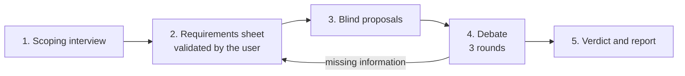
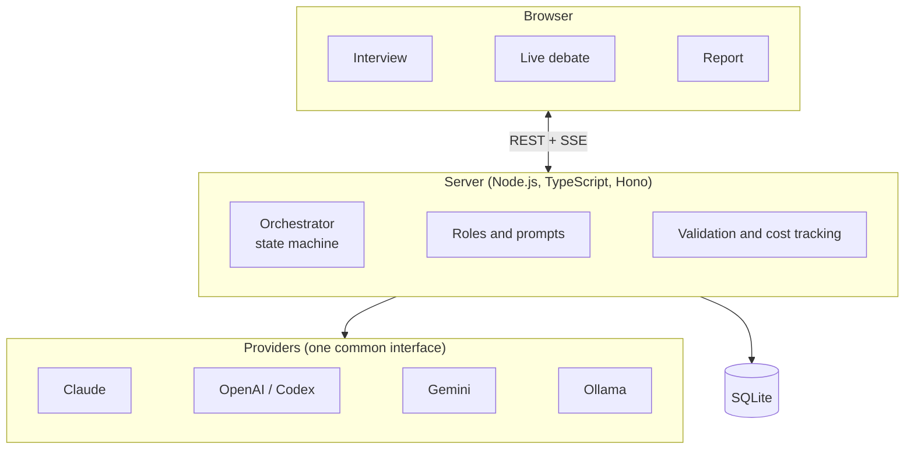

# Quorumind

**Several AIs debate your project before you build it.**

Quorumind first interviews you to pin down what you actually need: goals, scope, budget,
existing infrastructure, team skills and hard constraints. Then several AI models (Claude,
OpenAI / Codex, Gemini, local models via Ollama) each propose a solution, criticise each
other's proposals and revise their own. An arbiter weighs every option against your
requirements and tells you what is feasible, what is not, and why.

You get a decision report: targeted goals, compared options with their verdict, recommended
infrastructure, risks and a roadmap.

> **Status:** early design. The MVP is being built; nothing is usable yet.

## How it works

1. **Scoping interview.** One AI asks about goals, scope, users and load, budget, existing
   infrastructure, team skills, constraints (deadline, GDPR, imposed technologies) and
   priorities. Follow-up questions adapt to your answers.
2. **Requirements sheet.** A structured summary you correct and validate. It is the single
   source of truth for the rest of the session.
3. **Blind proposals.** Each proposer writes its solution without seeing the others, so
   nobody copies the first answer.
4. **Debate.** Cross-critiques (blocking, major, minor), a devil's advocate, then revisions.
   If a choice depends on information you did not give, the debate pauses and asks you.
5. **Verdict.** The arbiter marks each option feasible or not, scores it on your weighted
   priorities, and shows where the models still disagree.

## Roles

Roles are decoupled from models: any provider can play any role. Mixing models from different
vendors is the point, since they do not share the same blind spots.

| Role | Job |
| --- | --- |
| Interviewer | Runs the scoping interview, writes the requirements sheet |
| Proposers (2 to 4) | Each proposes a complete solution and defends it |
| Devil's advocate | Proposes nothing, attacks every option |
| Arbiter | Does not debate; checks each option against the requirements and rules |

## Architecture

- **Bring your own keys.** API keys stay server-side, in `.env`. A fully local debate with
  Ollama is possible: nothing leaves your machine.
- **Structured outputs.** Every role answers in a validated JSON schema; free text is for
  display, JSON drives the verdict and the report.
- **Cost cap.** Tokens and estimated cost are tracked per session and per model, with a
  configurable ceiling that stops the debate.

## Roadmap

1. **MVP:** one debate end to end: interview, requirements sheet, 2 proposers + arbiter,
   3 rounds, Markdown report. Claude and OpenAI.
2. **All providers:** Gemini and Ollama, devil's advocate, free role assignment, cost cap.
3. **Fact reliability:** optional web search for prices and versions, cited sources,
   interactive decision matrix.
4. **Collaboration:** multi-user sessions, PDF export, resumable sessions, handoff to a
   coding agent.

## Hosted version

A hosted version (no API keys needed, pay as you go or team plans) is planned. This
repository is and will stay the open source core.

## License

[GNU AGPL v3](LICENSE).
