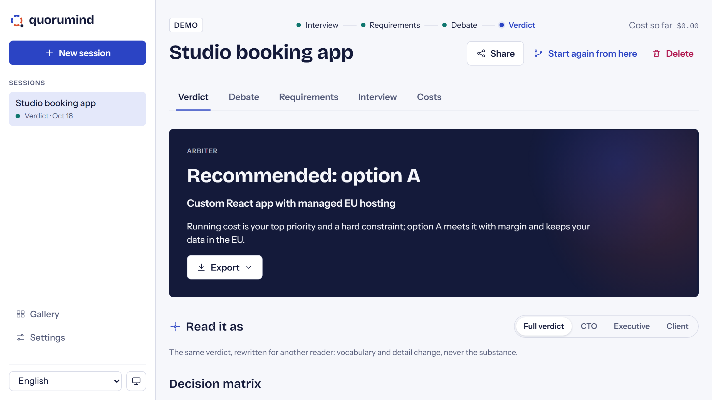
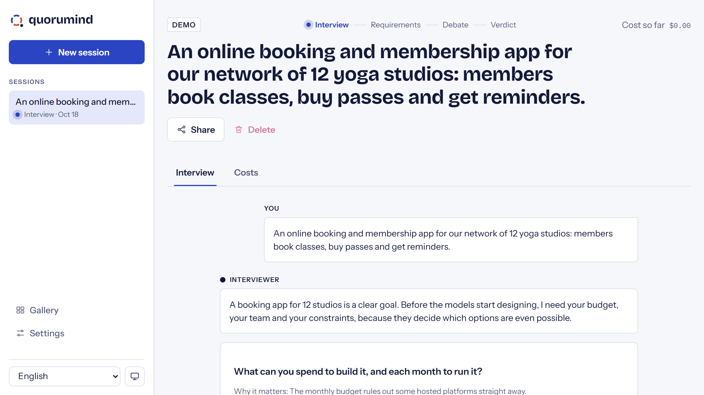
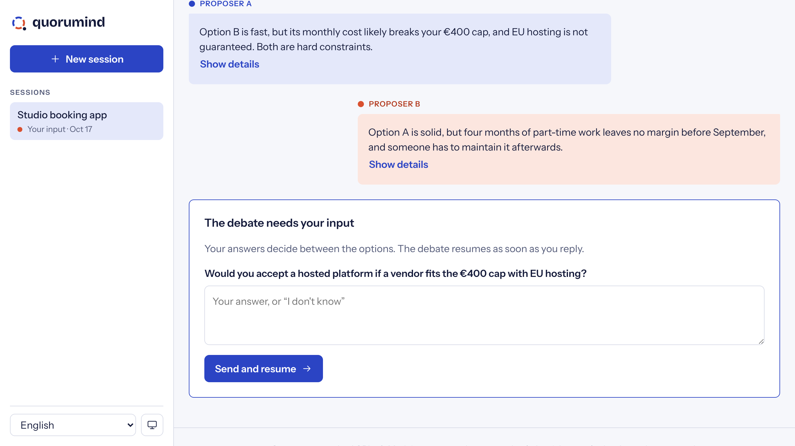
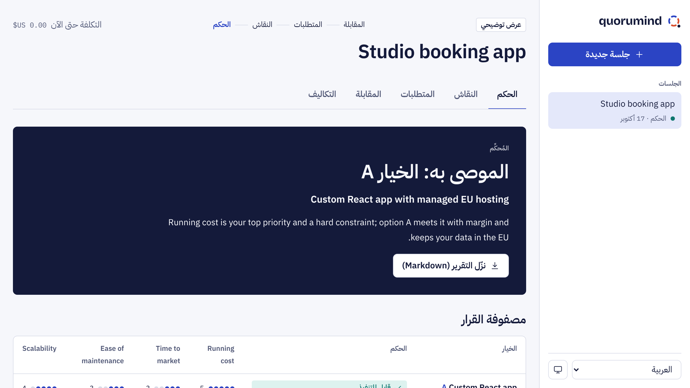
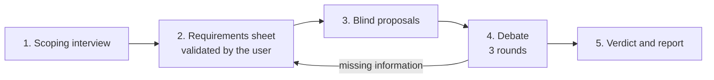
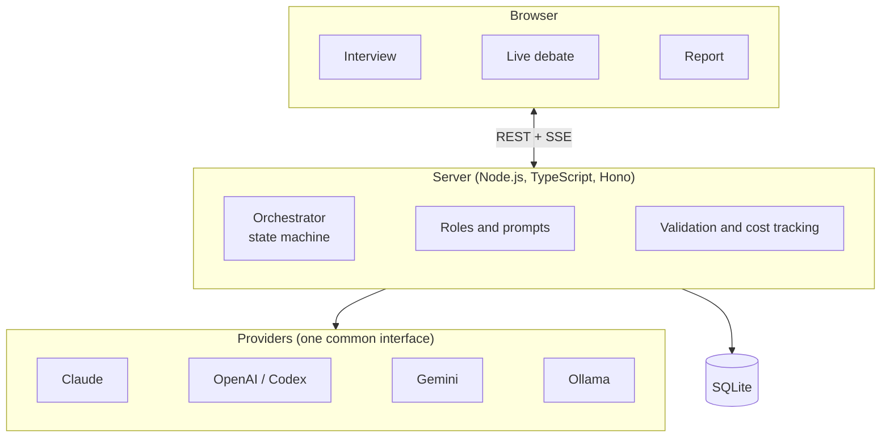

# Quorumind

**Several AIs debate your project before you build it.**

Quorumind first interviews you to pin down what you actually need: goals, scope, budget,
existing infrastructure, team skills and hard constraints. Then several AI models (Claude,
OpenAI / Codex, Gemini, local models via Ollama) each propose a solution, criticise each
other's proposals and revise their own. An arbiter weighs every option against your
requirements and tells you what is feasible, what is not, and why.

You get a decision report: targeted goals, compared options with their verdict, recommended
infrastructure, risks and a roadmap.

> **Status:** MVP in progress. The full flow works end to end: interview, requirements
> sheet, blind proposals, critiques, revisions, verdict and Markdown report, with Claude
> and OpenAI, in ten languages. A recorded demo runs without any API key.



| Interview | Debate | Arabic, right to left |
| --- | --- | --- |
|  |  |  |

## Quick start

Requirements: Node.js 22.18 or later.

```bash
npm install
cp .env.example .env     # add ANTHROPIC_API_KEY and/or OPENAI_API_KEY + OPENAI_MODEL
npm run build
npm start                # http://127.0.0.1:8787
```

Without any key, Quorumind starts in demo mode: click "Try the demo" to replay a recorded debate.

With Docker:

```bash
cp .env.example .env
docker compose up --build   # http://127.0.0.1:8787
```

The server has no user accounts yet: keep it on localhost or behind an authenticating
reverse proxy, never directly on the internet.

## Configuration

| Variable | Purpose |
| --- | --- |
| `ANTHROPIC_API_KEY` | Enables Claude. Every role defaults to `claude-opus-5-5` (`ANTHROPIC_MODEL` to change it, `ANTHROPIC_MODELS` for the models offered). |
| `OPENAI_API_KEY`, `OPENAI_MODEL` or `OPENAI_MODELS` | Enables OpenAI. With two vendors set, proposer B uses the second so two vendors debate. |
| `OPENAI_REASONING=1` | Sends the debate depth as `reasoning.effort`. Off by default: some models reject it. |
| `GEMINI_API_KEY`, `GEMINI_MODEL` or `GEMINI_MODELS` | Enables Google Gemini (`GEMINI_BASE_URL` to change the endpoint). |
| `OPENAI_PRICE_*`, `GEMINI_PRICE_*` (`_INPUT`, `_OUTPUT`) | USD per million tokens, applied to every listed model of that vendor, for cost tracking and the cost cap. |
| `OLLAMA_BASE_URL`, `OLLAMA_MODELS` | Enables local models through Ollama (free). Without `OLLAMA_MODELS`, the models Ollama has pulled are listed. |
| `QUORUMIND_LOCAL_ONLY=1` | 100 % local: only Ollama models are used, no data leaves the machine. |
| `QUORUMIND_INTERVIEWER`, `QUORUMIND_ARBITER`, `QUORUMIND_SEAT_A` to `QUORUMIND_SEAT_D`, `QUORUMIND_DEVIL` | Assign any model to any role, as `anthropic:<model>`, `openai:<model>`, `gemini:<model>`, `ollama:<model>` or `mock`. Seats C, D and the devil's advocate are off unless set (`QUORUMIND_DEVIL=none`). |
| `PORT`, `HOST`, `QUORUMIND_DATA_DIR` | Server address and where sessions are stored (SQLite). |

## How it works



1. **Scoping interview.** One AI asks about goals, scope, users and load, budget, existing
   infrastructure, team skills, constraints (deadline, GDPR, imposed technologies) and
   priorities. Follow-up questions adapt to your answers.
2. **Requirements sheet.** A structured summary you correct and validate. It is the single
   source of truth for the rest of the session.
3. **Blind proposals.** Each proposer writes its solution without seeing the others, so
   nobody copies the first answer.
4. **Debate.** Cross-critiques (blocking, major, minor), a devil's advocate, then revisions.
   If a choice depends on information you did not give, the debate pauses and asks you.
5. **Verdict.** The arbiter marks each option feasible or not, scores it on your weighted
   priorities, and shows where the models still disagree.

## Roles

Roles are decoupled from models: any provider can play any role. Mixing models from different
vendors is the point, since they do not share the same blind spots.

| Role | Job |
| --- | --- |
| Interviewer | Runs the scoping interview, writes the requirements sheet |
| Proposers (2 to 4) | Each proposes a complete solution and defends it |
| Devil's advocate | Proposes nothing, attacks every option |
| Arbiter | Does not debate; checks each option against the requirements and rules |

## Architecture



- **Bring your own keys.** API keys stay server-side, in `.env`. A fully local debate with
  Ollama is possible: nothing leaves your machine.
- **Structured outputs.** Every role answers in a validated JSON schema; free text is for
  display, JSON drives the verdict and the report.
- **Cost cap.** Tokens and estimated cost are tracked per session and per model, with a
  configurable ceiling that stops the debate.

## Languages

The interface ships in ten languages from the start: English (source), French, Spanish,
Portuguese, Italian, German, Hindi, Japanese, Simplified Chinese and Arabic, with full
right-to-left support for Arabic. The interview, the debate and the report follow the user's
language.

## Contributing

Everything in the codebase is written in English: code, comments, commit messages, issues
and documentation. User-facing strings live in translation files, never in the code.

## Development

```bash
npm run dev         # server on :8787 with reload, interface on :5173
npm test            # unit and API tests
npm run typecheck
npm run lint
npm run bench       # quality bench on the recorded demo
QUORUMIND_BENCH=live npm run bench   # the same bench on real models (costs money)
npm run media       # screenshots and demo video in docs/media, filmed on the recorded demo (needs ffmpeg)
```

| Path | Content |
| --- | --- |
| `packages/core` | Debate engine, role prompts, schemas, provider adapters (Claude, OpenAI, demo), pricing, report |
| `apps/server` | HTTP API, live event stream (SSE), SQLite storage, serves the interface |
| `apps/web` | React interface, ten languages, right-to-left support, light and dark themes |
| `bench` | Reference projects replayed end to end, with checks every verdict must pass |
| `media` | Films the recorded demo with Playwright for the README and the website |

Run the bench after any change to prompts, schemas or models: it is how we know whether a
change makes debates better or worse.

## Roadmap

1. **MVP:** one debate end to end: interview, requirements sheet, 2 proposers + arbiter,
   3 rounds, Markdown report. Claude and OpenAI.
2. **All providers:** Gemini and Ollama, devil's advocate, free role assignment, cost cap.
3. **Fact reliability:** optional web search for prices and versions, cited sources,
   interactive decision matrix.
4. **Collaboration:** multi-user sessions, PDF export, resumable sessions, handoff to a
   coding agent.

## Hosted version

A hosted version (no API keys needed, pay as you go or team plans) is planned. This
repository is and will stay the open source core.

## License

[GNU AGPL v3](LICENSE).
